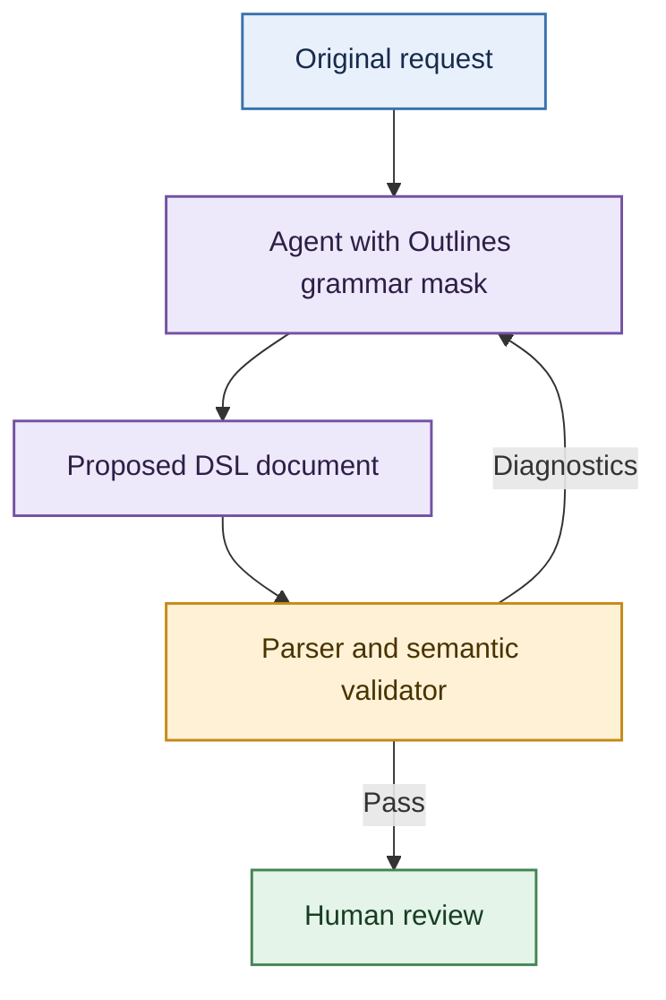

# From Grammar-Constrained Generation to Human-Reviewable Proposals

## Connecting DSL-mediated Agents with Outlines

Technical white paper | Steven Livengood | October 2026

### Abstract

A domain-specific language gives an agent a way to express proposals that both
software and people can inspect. _Outlines_ [2] helps by constraining LLM-generated
text to a grammar. But well-formed text can still break domain rules, and a
proposal that passes those rules can still miss the request. This project makes the
distinction concrete through the invented laboratory example from my earlier paper,
_DSL-mediated Agents: A Definition_ [1]. A runnable simulation combines grammar
masking, volume validation, semantic-feedback retries, and a handoff for human
review (with an optional local-model generation path). It illustrates software
design, not laboratory practice or scientific-agent performance.

Throughout this paper, **DSL** means the domain-specific language; a **DSL document**
is a document or text snippet that conforms to that language.

## 1. The document is the collaboration boundary

In _DSL-mediated Agents: A Definition_, I describe agents that use a shared,
well-defined domain language so software and experts can validate and process
their work. The shift is from instructions scattered across prompts and actions
to a document with explicit syntax and semantics.

The elements of that pattern map onto this implementation, with these
implementation-specific qualifications:

| DSL-mediated-agent element | Implementation |
| --- | --- |
| Well-defined domain language | Grammar and semantics reproduced in Appendix B |
| Agent reads and writes in the DSL | The optional Outlines path generates DSL documents; it does not demonstrate reading existing DSL documents |
| Validation | Parsing and application of semantic restrictions |
| Expert review | A passing DSL document is handed off for human review |
| Deterministic processing | Not demonstrated in this focused generation-and-validation example |

The repository's small laboratory DSL expresses additions, serial transfers,
incubation, and measurement rather than individual robot motions. Its DSL
documents give reviewers a compact object to inspect without claiming to cover
real protocols or govern runtime behavior. Experts can read and edit the domain
concepts, while software checks their explicit structure.



## 2. What grammar masking guarantees

An unconstrained model scores tokens without enforcing the target language.
Grammar masking [4] restricts each next-token choice to tokens consistent with the
grammar state of the current prefix, excluding tokens that make a valid completion
impossible. Conceptually, if `allowed(prefix)` is the set of permitted next tokens:

```text
masked_score(token) = model_score(token), if token is allowed
                      -infinity, otherwise
```

Sampling or greedy selection then operates over the remaining choices. Practical
engines account for token boundaries: one token can represent several characters,
so a token mask is not just a filter on individual letters.

Outlines exposes this constraint as `CFG(grammar)` [2, 3]. The simulation uses
LLGuidance, the backend that computes which next tokens the grammar allows. It
passes the same grammar to Lark for independent parsing. Outlines provides the
generation infrastructure; the grammar describes the language, and the validator
checks domain rules beyond syntax.

Willard and Louf [6] index the model vocabulary to efficiently identify tokens
permitted by a constraint state. They state that the approach extends to
context-free grammars by augmenting traditional LALR(1) parser components and
operations. This project uses Outlines with LLGuidance for CFG masking and focuses
on the separate semantic-feedback loop, not a comparison of masking algorithms.

This guarantee depends on a correct backend, compatible tokenizer, supported
grammar, and reaching an accepted end state. It does not ensure useful values or
completion within a token budget; the parser rejects incomplete DSL documents.

This is the point where the general grammar story meets the concrete laboratory
example. Even with a perfect mask, a model can produce a sentence that is valid in
the DSL but wrong for the intended protocol. `add 0 uL`, a repeated step name, or
a capacity violation breaks an encoded rule; a ten-fold dilution does so only when
an expected fold is explicitly supplied. Some restrictions can be expressed in a
grammar, but many are more naturally checked semantically.

This separation is also reflected in prior work: Netz, Reimer, and Rumpe study
grammar masking as a way to ensure syntactic validity in LLM-based modeling [4].
Their focus is conformance to a language, not whether a generated model captures
the user's intended meaning. That is the boundary illustrated here: masking
constrains form; semantic checks and review address meaning.

## 3. Three candidates, three different judgments

Consider this illustrative user request:

> Prepare a six-point, two-fold serial dilution of Sample S1 across wells A1-A6.
> Develop the wells, incubate for 15 minutes at 37 C, then measure absorbance at
> 450 nm. Keep each well at or below 200 uL.

The request leaves the buffer, transfer, and developing-reagent volumes to the
proposal. Here are three complete candidate DSL documents for that same request.

Assume grammar-constrained generation: completed DSL documents conform to the
grammar, while truncated text is rejected and retried. The candidates therefore focus on
semantic rules and intent rather than syntax.

**Candidate 1: syntactically valid, but over capacity**

```text
protocol "Dilution series and readout"
labware plate96 (max well volume 200 uL)

step dilute
  add 90 uL "Buffer A" to wells A2-A6
  add 100 uL "Sample S1" to well A1
  serial transfer 10 uL from A1 to A6, mixing 3 times at each well

step develop
  add 120 uL "Reagent B" to wells A1-A6
  incubate 15 min at 37 C

step read
  measure absorbance at 450 nm in wells A1-A6
```

The transfer proceeds between adjacent wells with ideal mixing and retains the
last transfer in A6. Before development, A1-A5 each hold 90 uL and A6 holds
100 uL. Adding 120 uL raises those volumes to 210 uL and 220 uL, respectively.
The document conforms to the grammar, but exceeds its declared per-well maximum.

**Candidate 2: within capacity, but the wrong dilution**

```text
protocol "Dilution series and readout"
labware plate96 (max well volume 200 uL)

step dilute
  add 90 uL "Buffer A" to wells A2-A6
  add 100 uL "Sample S1" to well A1
  serial transfer 10 uL from A1 to A6, mixing 3 times at each well

step develop
  add 100 uL "Reagent B" to wells A1-A6
  incubate 15 min at 37 C

step read
  measure absorbance at 450 nm in wells A1-A6
```

This version ends at 190 uL in A1-A5 and 200 uL in A6, so it satisfies the
encoded volume limit. But each transfer is ten-fold: 10 uL enters 90 uL of
buffer, giving `(90 + 10) / 10 = 10`. The default validator does not know the
request requires two-fold dilution, so it cannot identify that intent mismatch.
Supplying an explicit expected fold of 2 lets the optional semantic check flag it.

**Candidate 3: two-fold at each transfer, with a final-series caveat**

```text
protocol "Dilution series and readout"
labware plate96 (max well volume 200 uL)

step dilute
  add 50 uL "Buffer A" to wells A2-A6
  add 100 uL "Sample S1" to well A1
  serial transfer 50 uL from A1 to A6, mixing 3 times at each well

step develop
  add 100 uL "Reagent B" to wells A1-A6
  incubate 15 min at 37 C

step read
  measure absorbance at 450 nm in wells A1-A6
```

Here, 50 uL enters 50 uL of buffer at each receiving well, so each local
transfer is two-fold: `(50 + 50) / 50 = 2`. After development, A1-A5 hold
150 uL each and A6 holds 200 uL. The tracked Sample S1 fractions at readout are
1/3, 1/6, 1/12, 1/24, 1/48, and 1/64. The last transfer remains in A6, leaving
it with twice the pre-development volume of the preceding wells; equal reagent
additions therefore do not preserve a two-fold ratio between every final
readout concentration.

These candidate DSL documents illustrate distinct questions. Grammar acceptance
establishes that a document conforms to the DSL. Volume semantics can reject an
over-capacity proposal. An explicitly supplied fold requirement can catch the
ten-fold proposal. Human review still needs to decide whether “two-fold series”
means the transfer-stage ratio or the final readout concentrations. The DSL has
no discard command, so the final-volume asymmetry is visible but cannot be
repaired within this language.

Text2DSL provides context, not evidence about grammar masking: structured prompts
yielded **98.6-99.4% syntactic validity** in Polkit experiments, while experts
found semantic errors in **7 of 200 sampled rules** during dataset construction
[5, section 5.3, PDF p. 6]. These different stages and populations cannot be
combined into a syntax-versus-intent rate; neither result measures this simulation.

## 4. What the implementation demonstrates

The `generate --demo` command runs a deterministic three-attempt simulation.
A scripted responder selects fixed proposals from validator diagnostics; it is
not an LLM decision. Each proposal is replayed through Outlines'
`LLGuidanceLogitsProcessor` with a character tokenizer. The harness gives an
illegal carriage return a higher score at each position; the mask blocks it and
allows EOS only when the DSL document is complete. The validator checks each
document and its diagnostics select the next scripted proposal. Tests also cover
malformed prefixes and premature EOS. This demonstrates mechanics, not model
generation or learned repair.

An optional generation path uses a local Hugging Face causal language model, which
predicts each next token from the preceding text. It calls `outlines.from_transformers`,
`outlines.Generator`, and `CFG`, and can run the same prompt with or without a
mask. Each complete response is parsed and semantically validated; on failure, the
next prompt includes the previous proposal and diagnostics, including Lark's
line, column, and context for syntax errors, up to a bounded attempt limit. An
optional JSONL transcript records each rendered prompt, raw output, and diagnostics.
An optional live stream writes decoded text chunks to standard error while each
attempt is generated.

A truncated or otherwise invalid
response is diagnosed and retried; generation fails explicitly without saving a
proposal if the retry limit is exhausted.

Integration tests use a locally synthesized tiny GPT-2 model and scripted scores
to test completion, truncation, and prose rejection. They verify plumbing, not
pretrained-model quality or learned semantic repair.

In seeded runs with the small SmolLM2-360M-Instruct model, both constrained and
unconstrained generation exhausted three attempts without producing a semantically
valid proposal. With grammar masking, the attempts produced syntactically valid
DSL documents, but failed semantic checks, including capacity, duplicate-step,
cross-row range, and empty-well-read checks. Without masking, the outputs included
malformed DSL and prose and failed parsing. The important distinction is that the
grammar mask secured syntax, not semantic correctness or fidelity to the request.
These are qualitative observations from one example, not a model-quality
benchmark, and do not show that model size caused the difference.

The grammar permits additional commands and steps without a fixed count, so
masking syntax alone does not ensure that generation terminates. For constrained
generation, token selection is biased toward EOS (the end-of-sequence token) at
grammar-accepted stopping points: after one-eighth of the token budget it is
given a 75% chance, and when 64 or fewer tokens remain it is forced at the first
accepted stopping point. The hard token budget remains the final bound; if EOS
is not grammar-allowed by then, the incomplete output is rejected. This stopping
policy controls length, not semantic quality.
The unconstrained comparison uses the same sampling settings without this policy;
the EOS preference is bundled with grammar masking because masking alone does not
make the model terminate.

### Grammar compatibility

Using one grammar file does not ensure that different engines interpret it
identically. The tests compare the Outlines/LLGuidance mask with Lark on the
examples, mutated documents, and documents generated by walking the mask.
The normal parser path is Lark's LALR parser; the tests also use Lark's Earley
parser as an additional ambiguity and disagreement check. No disagreements or
ambiguous parses were found in this corpus. This extra check gives finite
regression evidence for this grammar and corpus, not proof that the parsers will
always agree. Appendix A gives the test details.

### Validation and review

The validator tracks volumes as integers and sample fractions with exact rational
arithmetic. Appendix B lists its enforced rules; an expected-fold check applies
only when explicitly supplied. Tests include transient transfer overflow.

Validation cannot establish that a proposal matches the user's intent. A reviewer
must compare the DSL document with the original request and consider requirements
that are not encoded in the validator.

In short: the validator checks encoded rules, the retry loop feeds failures back
to generation, and a human reviewer remains responsible for intent.

## 5. Limits and next steps

This demonstration is not a laboratory protocol or a scientific workflow. It is a
software illustration of a DSL-mediated agent: a narrow language, grammar
constraint, validation layer, and handoff point for human review. The simulated
chemistry is deliberately minimal. It does not check reagent compatibility,
actual equipment capacities, thermal safety, sterility, optical suitability, or
scientific validity. It also does not enforce the complete request's point count,
ordering, timing, or sample identity. The optional fold check concerns receiving
volume, not the final concentration series. Passing these checks is not evidence
of laboratory safety.

The next step is a systematic evaluation with pretrained models to study how well
the validation-feedback loop works in a realistic generation setting. Preserve the
grammar and validator versions, model and tokenizer revisions, prompt, decoding
settings, token budget, environment, and all attempts. Compare constrained and
unconstrained runs with the same inputs and report separately:

1. **Completion rate:** complete documents divided by all attempts, including errors.
2. **Syntax rate:** parseable documents divided by all attempts; also report the
   conditional rate among completed outputs.
3. **Encoded-rule rate:** documents satisfying a specified validator version.
4. **Intent rate:** independent expert assessment against the request, with a stated
   rubric, sample size, and disagreement process.
5. **Cost and latency:** including grammar compilation, rejection, and repair loops.
6. **Attempts to success:** proposals to the first complete, semantically valid
   result, with syntax and semantic repair attempts reported separately.

To assess performance practicality, run both modes with the same model, tokenizer,
hardware, prompts, and generation settings. Measure end-to-end latency and
throughput as well as the mask's incremental cost, including grammar or processor
setup; repeat across representative document lengths and report run-to-run
variation. Compare the overhead with the application's latency and throughput
requirements.

## Conclusion

The value of a DSL-mediated agent is not that it removes the need for judgment.
It gives judgment a clear object: a document that software can check and a person
can compare with the request. Outlines strengthens the first boundary by
constraining syntax. Validation checks the rules we have encoded, and semantic
feedback gives the generator a bounded opportunity to correct failures. Review
addresses what those rules leave open.

## Appendix A. Parser and tokenizer checks

The [compatibility tests](../tests/test_grammar_compatibility.py) compare the
grammar used by Outlines/LLGuidance and Lark. Lark's contextual LALR parser handles
normal parsing and validation. The Earley check found no disagreements or
ambiguous parses in this corpus. Results are finite evidence for this grammar and
corpus, not a guarantee for all documents, tokenizers, or parser configurations.

The corpus and checks include:

- All three grammatical examples and 36 seeded character mutations per example:
  deletions, insertions, and adjacent-character swaps.
- Near-miss negatives: lowercase units, one-space or tab indentation, a missing
  final newline, markdown fences, a missing step separator, and CRLF endings.
- Sixteen seeded random walks choosing allowed tokens from the mask, each capped
  at 1,024 tokens and required to complete. Permission to end the document is
  compared with LALR acceptance at every reached prefix, including mutation replays.
- The same full inputs parsed with Earley using `lexer="dynamic_complete"` and
  `ambiguity="explicit"`. Acceptance must agree, and accepted trees must contain
  no `_ambig` node. A reversed well range must parse in both engines but fail
  the semantic `RANGE` check.
- Optional byte-level BPE (byte-pair encoding) coverage. BPE builds tokens by
  repeatedly merging common adjacent units. The test trains a tokenizer locally
  on the examples and saves it as JSON; no model weights are needed. Assertions
  confirm that multi-character tokens cross grammar boundaries, and all examples
  and near-miss negatives are replayed.

This corpus checks useful sources of disagreement without covering every possible
document, pretrained tokenizer, or Unicode boundary.

## Appendix B. DSL grammar, semantics, and restrictions

The grammar and the interpretation and validation rules for DSL documents follow.

### Grammar

```lark
start: "protocol " STRING _NL "labware plate96 (max well volume " INT " uL)" _NL _NL step (_NL step)* _NL?
step: "step " NAME _NL command+
?command: add | transfer | incubate | measure
add: "  add " INT " uL " STRING " to " targets _NL
transfer: "  serial transfer " INT " uL from " WELL " to " WELL ", mixing " INT " times at each well" _NL
incubate: "  incubate " INT " min at " INT " C" _NL
measure: "  measure absorbance at " INT " nm in " targets _NL
?targets: "well " WELL -> single
        | "wells " WELL "-" WELL -> span
STRING: /"[^"\n\r\\]{1,60}"/
NAME: /[a-z][a-z0-9_]{0,31}/
WELL: /[A-H](1[0-2]|[1-9])/
INT: /0|[1-9][0-9]{0,5}/
_NL: "\n"
```

Quoted strings contain 1 to 60 characters; integer tokens contain 1 to 6
digits, with no leading zero except for `0`. Names contain 1 to 32 lowercase
letters, digits, or underscores, beginning with a letter.

### Semantics

A DSL document names a protocol, declares a maximum volume for each well, and lists
ordered steps. Steps execute in document order, and commands within each step
execute in their listed order. Step names label the steps; they do not change
command meaning. Each well begins empty. Volumes are measured in uL, incubation
duration in minutes, temperature in C, and absorbance wavelength in nm.

A target names one well or an inclusive range within a single row. For example,
`wells A2-A4` denotes A2, A3, and A4. Ranges run from the first well to the last;
reversed or cross-row endpoints do not denote a valid range.

An `add` command adds the stated volume to each selected well. All added material
increases volume. For the abstract sample accounting, only material labeled
exactly `Sample S1` contributes tracked sample mass; other labels contribute none.
For example, `add 50 uL "Buffer" to wells A2-A4` adds 50 uL to each of the three
wells, not 50 uL divided among them.

A `serial transfer` runs through the wells from its first endpoint to its last,
one adjacent pair at a time. At each pair, the stated volume moves from source to
receiver, reducing the source volume and increasing the receiver volume by that
amount. The transferred sample mass is proportional to the source's tracked
sample concentration, assuming ideal mixing. Each receiver is mixed before it
becomes the next source, using the specified number of mixing cycles. The final
transfer remains in the last well; nothing is discarded. For example,
`serial transfer 50 uL from A1 to A3, mixing 3 times at each well` means 50 uL
moves A1-to-A2, then 50 uL moves A2-to-A3; it is not one direct transfer from A1
to A3.

The sample fraction in a well is its tracked `Sample S1` mass divided by its
volume. If a well contains 50 uL of buffer and receives 50 uL of a well-mixed
sample, the local dilution is two-fold: the resulting volume is 100 uL, of which
50 uL is transferred sample. Subsequent additions change the volume and therefore
may change the sample fraction.

An `incubate` command specifies a duration and temperature. A `measure absorbance`
command specifies a wavelength and target wells. Neither command changes the
volume or tracked sample mass in this model. These meanings define the abstract
semantics of DSL documents, not physical laboratory behavior.

### Semantic restrictions

The validator enforces these rules in addition to the grammar:

- The declared per-well maximum is 1-200 uL. Volume must remain within that limit
  after each addition and at every intermediate transfer.
- Step names must be unique, and target ranges must ascend within one row.
- Addition and transfer volumes must be positive. Transfers require positive
  mixing, at least two wells, and sufficient volume at each source.
- Incubation duration and measurement wavelength must be positive; measured wells
  must not be empty.
- If an expected fold is explicitly supplied, each transfer must match
  `(receiving volume before transfer + transfer volume) / transfer volume`.
  The validator does not infer this requirement from prose.

The complete example is Candidate 3 in Section 3. It illustrates the same
semantics: the final transfer remains in A6, so A6 ends with a larger volume and
its final sample fraction does not continue the two-fold series.

## License and attribution

Original contributions: [MIT License](../LICENSE), copyright (c) 2026 Steven Livengood.
The adapted worked example retains its CC BY 4.0 attribution and license terms;
see [NOTICE](../NOTICE) and reference [1].

## References

1. Livengood, S. (2026). _DSL-mediated Agents: A Definition_.
   [Source text](https://github.com/thirdrailsoftware/dsl-mediated-agents/blob/main/definition.md);
   [DOI: 10.5281/zenodo.23587494](https://doi.org/10.5281/zenodo.23587494).
   [CC BY 4.0](https://creativecommons.org/licenses/by/4.0/).
   The worked example is adapted here into executable software. The readout and
   study-population clarifications in this paper do not update that publication.
2. .txt / Outlines contributors. _Outlines_.
   [Project](https://github.com/dottxt-ai/outlines);
   [upstream README](https://github.com/dottxt-ai/outlines#readme).
   The upstream recommended research citation is Willard and Louf [6].
3. Outlines documentation. _Output Types_, especially context-free grammars and
   model-specific availability.
   [Documentation](https://dottxt-ai.github.io/outlines/latest/features/core/output_types/).
   This repository pins Outlines 1.2.9 and LLGuidance 1.3.0; online documentation may evolve.
4. Netz, L., Reimer, J., & Rumpe, B. (2024). _Using Grammar Masking to Ensure
   Syntactic Validity in LLM-based Modeling Tasks_. MODELS Companion workshop.
   [arXiv:2407.06146](https://arxiv.org/abs/2407.06146).
5. Kozachok, A., Nazimov, A., & Magomedov, S. (2026). _Text2DSL: LLM-Based Code
   Generation for Domain-Specific Languages_. KES 2026 / Procedia Computer Science.
   [arXiv:2606.22586](https://arxiv.org/abs/2606.22586).
   Syntax results: abstract and experimental results; expert review: section 5.3,
   PDF p. 6. These findings describe different stages and populations.
6. Willard, B. T., & Louf, R. (2023). _Efficient Guided Generation for Large
   Language Models_. [arXiv:2307.09702](https://arxiv.org/abs/2307.09702).
